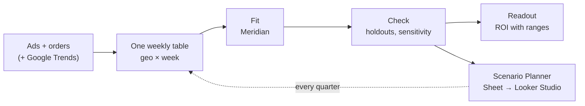

# Meridian MMM toolkit

A ready-to-use setup for **marketing mix modelling (MMM)** with Google's open-source
[Meridian](https://github.com/google/meridian), for any brand.

An MMM looks at a few years of weekly sales and ad spend. It works out how much of the sales
each channel actually *caused* (not just touched), how sure it can be, and where the next
pound would earn most. This toolkit packages one complete, tested way of doing that: the
data, the model, the checks, the budget planner and the quarterly refresh. A new brand is a
config file, not new code.

> **New to MMM?** Start with the [cheat sheet](docs/CHEATSHEET.md). It explains the idea, the
> numbers and the traps in plain English, in about ten minutes.
> The thinking behind this setup is in the Performify Labs article
> [Bayesian MMM with Google Meridian, in practice](https://performify.co.uk/labs/bayesian-mmm-meridian-in-practice/).

---

## What you get

- **One config file per brand** ([`example/mmm.yaml`](example/mmm.yaml)). Markets, channels,
  priors, tests, cloud names and the planner sheet all live there. Nothing else needs editing.
- **A model notebook** that fits Meridian, checks it, reports ROI with honest ranges, runs
  budget scenarios and saves the model.
- **Built-in protection against the classic mistakes:** a demand control (so brand-harvesting
  channels can't take credit for existing demand), three kinds of holdout test, and guardrails
  that stop a run if spend goes missing.
- **Batches of fits** in the cloud (Colab Enterprise), to compare settings side by side.
- **The Meridian Scenario Planner**: an interactive Looker Studio budget planner, refreshed
  automatically.
- **A quarterly refresh** that runs with nobody involved.
- **A plain-English readout** (markdown and charts) and an
  [assumptions register](docs/ASSUMPTIONS_TEMPLATE.md) template.
- **A synthetic brand with known answers**, so you can try everything, and check the model
  gets close to the truth, before touching real data.

## How it works



1. **One table.** The model reads one row per market per week: sales, spend and impressions
   per channel, and the things that move sales but aren't ads. `mmm/sql_views.py` can build
   it in BigQuery from an ads table and an orders table.
2. **Fit.** Meridian estimates each channel's effect, including how long it lasts (carry-over)
   and where extra spend stops paying (saturation).
3. **Check.** Hide some weeks, see if the model predicts them. Change one assumption at a
   time, and see what moves.
4. **Use it.** A readout for people, a planner for budgets, and a refresh every quarter.

---

## Try it in five minutes (no cloud, no client data)

You need Python 3.11 or 3.12 (Meridian doesn't support 3.13+ yet).

```bash
git clone https://github.com/performify-github/meridian-mmm-toolkit.git
cd meridian-mmm-toolkit
python3.12 -m venv .venv && source .venv/bin/activate
pip install -r requirements.txt

python3 mmm/synthetic.py --config example/mmm.yaml          # a fake brand, with known true returns
python3 mmm/run_mmm.py --config example/mmm.yaml check --data
python3 mmm/run_mmm.py --config example/mmm.yaml local --sampling smoke --run-id demo
python3 mmm/readout.py --config example/mmm.yaml --main demo --local-dir runs --out readout
```

`smoke` sampling takes about a minute and only proves the plumbing works. For numbers worth
reading, use `--sampling standard` (about 5–15 minutes on a laptop). Compare the result with
`example/data/synthetic.truth.json`.

**Example outputs** from a standard fit on the synthetic brand are in
[`example/outputs/`](example/outputs/): Meridian's own HTML report, a budget-scenario report
and the readout.

---

## Start a new brand

1. **Copy the example folder** into the brand's own repo: `mmm.yaml`, `priors.csv`, `grids/`.
   Keep client config and data out of this repo.
2. **Fill in `mmm.yaml` from the top down.** Each block says what it's for. Every date must
   be a week start (a Monday by default).
3. **Build the input table.** Either fill the `sql` block and run
   `python3 mmm/sql_views.py --config <brand>/mmm.yaml`, or make your own table with the
   [input columns](#the-input-table). Then read the generated `qa_campaign_channel_map.sql`
   once by eye: it lists every campaign and the channel it landed in.
4. **Add a demand series** if you can: brand-search clicks, Google Trends for the brand
   (`mmm/trends.py`), or both. This is the single biggest protection against over-crediting
   lower-funnel channels.
5. **Set the priors** in `priors.csv`, with a source on every row
   ([cheat sheet §3](docs/CHEATSHEET.md#3-setting-priors)).
6. **Check:** `run_mmm.py --config <brand>/mmm.yaml check --data`.
7. **Smoke-test, then validate:** run `grids/smoke.txt`, then `grids/validation.txt`, then
   `grids/sensitivity.txt`. Choose the settings on the holdout tests, not on how well the model
   fits the weeks it has seen. Put the winner in `main_fit`.
8. **Write the assumptions register** from [the template](docs/ASSUMPTIONS_TEMPLATE.md), and go
   through it with the client before presenting numbers.
9. **Set up the planner and the refresh** (below).

---

## Set up Google Cloud (once per project)

Cloud runs use **Vertex AI Colab Enterprise**: the same notebooks, run as a job in your
project, billed by the hour. A fit on 8 vCPU takes about 10–15 minutes and costs pennies.
More cores barely help, and a GPU isn't needed; run fits side by side instead.

Fill in the `gcp` block of `mmm.yaml` as you go. The commands use these variables:

```bash
PROJECT=your-gcp-project
REGION=europe-west2
BUCKET=your-mmm-bucket
SA=mmm-runner@$PROJECT.iam.gserviceaccount.com
```

**1. Turn on the APIs.**

```bash
gcloud services enable aiplatform.googleapis.com notebooks.googleapis.com dataform.googleapis.com compute.googleapis.com bigquery.googleapis.com storage.googleapis.com sheets.googleapis.com drive.googleapis.com --project=$PROJECT
```

**2. Make the output bucket** (every run's files land here).

```bash
gcloud storage buckets create gs://$BUCKET --location=$REGION --uniform-bucket-level-access --project=$PROJECT
```

**3. Make the service account the notebooks run as, and give it exactly what it needs.**

| Role | Where | Why |
|---|---|---|
| Colab Enterprise User (`roles/aiplatform.colabEnterpriseUser`) | project | Start notebook runs, including the orchestrator starting child fits |
| BigQuery Job User (`roles/bigquery.jobUser`) | project | Run the query that reads the input |
| BigQuery Data Viewer (`roles/bigquery.dataViewer`) | project, or the datasets behind the input view | Read the input. A view needs access to the tables it reads too |
| Storage Object Admin (`roles/storage.objectAdmin`) | the bucket | Read and write run files |
| Storage Legacy Bucket Reader (`roles/storage.legacyBucketReader`) | the bucket | Colab needs `storage.buckets.get` to save the executed notebook, and Object Admin doesn't include it |
| Service Account User (`roles/iam.serviceAccountUser`) | **itself** | The orchestrator launches child fits that run as the same account |
| Service Account Token Creator (`roles/iam.serviceAccountTokenCreator`) | **itself** | Mint a Sheets-scoped token for the planner sheet: runtime tokens carry cloud-platform only |

```bash
gcloud iam service-accounts create mmm-runner --display-name="MMM runner" --project=$PROJECT
for ROLE in roles/aiplatform.colabEnterpriseUser roles/bigquery.jobUser roles/bigquery.dataViewer; do
  gcloud projects add-iam-policy-binding $PROJECT --member=serviceAccount:$SA --role=$ROLE
done
for ROLE in roles/storage.objectAdmin roles/storage.legacyBucketReader; do
  gcloud storage buckets add-iam-policy-binding gs://$BUCKET --member=serviceAccount:$SA --role=$ROLE
done
for ROLE in roles/iam.serviceAccountUser roles/iam.serviceAccountTokenCreator; do
  gcloud iam service-accounts add-iam-policy-binding $SA --member=serviceAccount:$SA --role=$ROLE --project=$PROJECT
done
```

People who start runs need Colab Enterprise User (Admin to create templates), Service Account
User on `$SA`, and Storage Object Admin on the bucket.

**4. Make two runtime templates** (the machines runs start on). Use a standard disk: see Quotas.

```bash
gcloud colab runtime-templates create --region=$REGION --project=$PROJECT --runtime-template-id=mmm-cpu-n2-8 --display-name="MMM fit (n2-standard-8)" --machine-type=n2-standard-8 --disk-type=PD_STANDARD --disk-size-gb=100 --idle-shutdown-timeout=30m
gcloud colab runtime-templates create --region=$REGION --project=$PROJECT --runtime-template-id=mmm-orchestrator-n2-2 --display-name="MMM orchestrator (n2-standard-2)" --machine-type=n2-standard-2 --disk-type=PD_STANDARD --disk-size-gb=100 --idle-shutdown-timeout=30m
```

**5. Check the quotas, and set `gcp.max_parallel`.** Colab Enterprise **fails** a run that would
go over quota; it doesn't wait. (The `queue` command retries those for you, but it's wasteful.)
Three quotas bite, all in IAM & Admin → Quotas:

| Quota | Each runtime uses | So `max_parallel` is at most |
|---|---|---|
| CPUs (all regions) | 8 per fit, 2 for the orchestrator | (quota − 2) ÷ 8. Newer projects often start at 32 → 3 |
| In-use external IP addresses (per region) | 1 | quota − 1 |
| Persistent Disk SSD (GB, per region) | **~100 GB**, whatever disk type the template sets (the boot disk is SSD) | quota ÷ 100 − 1 |

GPU quota requests are often refused on young projects. You don't need one.

**6. First cloud run.**

```bash
python3 mmm/run_mmm.py --config <brand>/mmm.yaml submit --sampling smoke --run-id first-cloud-test
python3 mmm/run_mmm.py --config <brand>/mmm.yaml status first-cloud-test
```

The executed notebook, with every output, is in Vertex AI → Colab Enterprise → Executions,
and in `gs://$BUCKET/<prefix>/runs/first-cloud-test/`.

---

## The Scenario Planner

Meridian's Scenario Planner (open beta) is a Looker Studio report on top of a Google Sheet.
People pick a period and a budget, and it shows the recommended split and the response
curves. **Service accounts can't own Drive files**, so a person owns the sheet:

1. **Create an empty Google Sheet** as the person (or in the Shared Drive) who should own the
   report.
2. **Share it with the service account** (`$SA`) as **Editor**.
3. **Put its id** (the long string in the sheet's URL) in `planner.spreadsheet_id`.
4. **Run the chain once:** `run_mmm.py --config <brand>/mmm.yaml sync`, then
   `run_mmm.py --config <brand>/mmm.yaml orchestrate`.
5. **Open the report link** (`report_url` in `gs://$BUCKET/<prefix>/planner_latest.json`)
   signed in as the sheet's owner, and click **Edit and save**. Do this once. If you're signed
   in to several Google accounts, check the link opens under the owner (the `/u/N/` part of
   the URL).

After that, every refresh rewrites the same sheet in place, keeping its tabs, so the saved
report updates itself. Beta limits: the data is embedded in the report, it runs on the owner's
credentials, and only the owner can edit it.

## The quarterly refresh

```bash
python3 mmm/run_mmm.py --config <brand>/mmm.yaml sync        # after any change to code or config
python3 mmm/run_mmm.py --config <brand>/mmm.yaml schedule    # once: 06:00 on 7 Jan/Apr/Jul/Oct by default
```

`sync` copies the toolkit code and the brand's config, priors and grids to
`gs://$BUCKET/<prefix>/code/`, with the git commits in `VERSION.json`. The schedule runs the
orchestrator there, which runs `grids/refresh.txt`, builds the planner tables from the run
marked `main`, and updates the sheet. `code/main.ipynb` is the main fit, ready for anyone to
open in Colab Enterprise and click **Run all**.

---

## Everyday commands

Every command takes `--config <brand>/mmm.yaml` (or set `MMM_CONFIG`).

| To… | Run |
|---|---|
| Check the config, grids and input table | `run_mmm.py check --data` |
| Fit on this machine | `run_mmm.py local --sampling standard` |
| Fit in the cloud | `run_mmm.py submit --sampling standard --holdout random` |
| See a cloud run | `run_mmm.py status <run_id>` |
| Run a batch, N at a time | `run_mmm.py queue validation.txt` |
| Build the planner tables | `run_mmm.py planner <run_id> --wait` (or `--local`) |
| Write them to the sheet | `run_mmm.py publish <planner_run_id> --as-sa` |
| The whole chain, in the cloud | `run_mmm.py orchestrate --grid refresh.txt` |
| A readout for people | `readout.py --main <run> --validation <runs…> --sensitivity <runs…> --out DIR` |
| Rebuild the BigQuery views | `sql_views.py` |
| Refresh Google Trends | `trends.py fetch --out t.csv`, then `trends.py load --csv t.csv` |

**Run settings** are flags, and anything you don't set comes from `main_fit`:
`--kpi`, `--sampling smoke|quick|standard`, `--holdout <name>`, `--knots monthly|quarterly|aks|<n>`,
`--fourier <pairs>`, `--demand-control clicks+trends|none`, `--priors <file>`,
`--priors-scale 0.5`, `--window-end YYYY-MM-DD`, `--no-optimise`, `--no-report`, `--no-save`.

**Grid files** (`grids/*.txt`) hold one line of flags per run, each with a `--run-id`.
`{date}` in a run id becomes today's date. The examples:

| Grid | What it answers |
|---|---|
| `smoke.txt` | Does the plumbing work? (minutes) |
| `validation.txt` | Can the model predict weeks it hasn't seen, with and without the demand control? |
| `sensitivity.txt` | Which assumptions move the answer? One change per line |
| `refresh.txt` | The scheduled refresh: the main fit plus the three holdouts |

## What each run produces

Cloud runs write to `gs://<bucket>/<prefix>/runs/<run_id>/`; local runs to `runs/<run_id>/`.

| File | What's in it |
|---|---|
| `run_summary.json` | The headline numbers: data totals, convergence, Meridian's review, holdout accuracy, ROI / marginal ROI / share per channel with 90% ranges, budget scenarios |
| `model_summary.html` | Meridian's own report: fit, contribution, ROI, response curves |
| `optimisation_x0.8 / x1.0 / x1.2.html` | Budget scenarios at −20%, the same and +20% |
| `summary_metrics.csv`, `predictive_accuracy.csv`, `optimisation_scenarios.csv` | The full tables |
| `model.binpb` | The fitted model (`meridian.schema.serde.meridian_serde.load_meridian`) |
| `notebook.ipynb` (+ `executed/` in the cloud) | Exactly what ran: config, priors and settings are in its second cell |

## The input table

One row per geo per week, every geo in every week. Column names are set in `mmm.yaml`.

| Column | What it is |
|---|---|
| `week_start` | The week's first day (a Monday by default) |
| `geo` | The market, matching a key in `geos` |
| KPI columns (e.g. `orders`, `new_customers`) | What the model explains |
| Revenue columns (e.g. `revenue`) | Revenue for each KPI, so ROI reads in money |
| `spend_<channel>`, `impressions_<channel>` | Per channel in `channels` |
| Demand series (e.g. `brand_search_clicks`, `brand_trends_index`) | Named in `demand_controls.series` |
| Other controls (e.g. `discount_depth`, `sale_campaign_live`) | Listed in `controls` |
| Guardrails (optional): `unmapped_spend`, `unmapped_geo_spend_all_geos`, other spend | Spend with no channel or no geo. A run stops if they're too big |

Calendar flags (Black Friday, Christmas, New Year, Easter), one-off events, seasonality waves
and population are added by the notebook.

---

## Gotchas (learned the hard way)

- **Every date is a week start.** Meridian's time points are week starts, so holdout and
  optimisation dates must be one too. `check` catches it.
- **Always set knots in a geo model.** Leaving them unset gives every week its own baseline,
  which swallows any campaign that ran in all markets at once. `monthly` is a good default.
- **Hiding a whole peak season in every market needs Fourier terms** (`fourier: 2`), or the
  sampler has nothing to anchor those weeks and won't converge. Hiding it in one market only
  (`geo_dates`) is gentler: the others still show the seasonal shape.
- **A lower-funnel ROI above the platform's own reported ROAS is a warning, not a win.** If it
  barely moves when you halve its prior, demand is leaking into it. Add or strengthen the demand
  control; don't tune the prior to hide it.
- **PMax brand exclusions don't stop its Shopping ads serving on brand searches.** Check the
  campaign's search-term insights before calling PMax incremental.
- **"New customer" flags in commerce data often mean "has only ever ordered once"**, not "first
  order". The SQL works out first orders itself.
- **Download BigQuery results over REST** (`create_bqstorage_client=False`) unless the service
  account also has Read Session User. The frame is small anyway.
- **The planner's Looker Studio connector rejects a bare `/d/<id>` sheet URL.** `publish`
  passes the API's own `…/edit` URL.
- **Google Trends via `pytrends` is unofficial** and rate-limited. The script backs off and
  retries, then skips that country; re-fetch rather than force it.

## Repo layout

```
mmm/
  run_mmm.py           the runner: check, local, submit, queue, planner, publish, sync, orchestrate, schedule
  config.py            loads, fills in and validates mmm.yaml
  fit.py               the model notebook (percent-cell format; edit this, not a built .ipynb)
  scenario_planner.py  the planner-tables notebook
  orchestrator.py      the cloud notebook that runs a grid → planner → sheet
  sql_views.py         renders the BigQuery input views from the config
  trends.py            Google Trends → a demand series per geo
  synthetic.py         a fake brand with known true returns
  readout.py           a plain-English markdown readout with charts
example/               the fictional brand: mmm.yaml, priors.csv, grids/, sql/, data/, outputs/
docs/                  CHEATSHEET.md, ASSUMPTIONS_TEMPLATE.md
tests/                 python3 -m pytest tests   (MMM_SLOW=1 adds a real local fit)
```

## Licence

MIT, © Performify Ltd. `mmm/scenario_planner.py` is adapted from Google's Meridian Scenario
Planner demo notebook (Apache License 2.0). Meridian itself is Apache 2.0.
