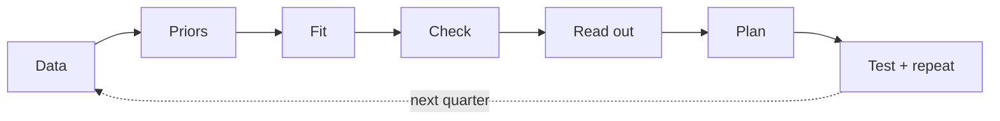

# Marketing mix modelling: the cheat sheet

*What an MMM is, how this one works, what every number means, and where it goes wrong. Plain
English first, detail second. A [glossary](#8-glossary) is at the end.*

---

## 1. The idea in one minute

Every week, some sales would have happened anyway, and some happened because of the ads.
**An MMM splits the two apart.**

It looks at two or more years of weekly sales and spend, across several markets, and asks:
*when a channel's spend went up or down, did sales follow, once everything else that moves
sales has been accounted for?*

Its answers:

| It answers | It doesn't answer |
|---|---|
| How much each channel **caused**, with an honest range | Which ad, audience or creative worked (that's platform testing) |
| Where the **next** pound earns most | What happens far outside the spend levels it has seen |
| How to split a budget across channels | Sales it can't see (shops, marketplaces) |
| How long effects last, and where channels saturate | Day-to-day bidding |

**Why not just use the platforms' numbers?** Google and Meta report *attribution*: who touched
the sale. They claim sales from people who would have bought anyway (brand searches, past
customers) and miss effects with no click. An MMM estimates *incrementality*: what wouldn't
have happened without the spend. The two should differ. If a lower-funnel channel's MMM return
comes out **above** what its own platform claims, be suspicious (§7).

---

## 2. How the model works

```
weekly sales  =  baseline  +  the effect of each channel  +  noise
```

- **Baseline:** what would sell with no paid media. Existing demand for the brand, the
  seasons, promotions, holidays.
- **Each channel's effect** has two shapes:
  - **Carry-over** (adstock): some of this week's ad effect lands in later weeks. Search
    fades in days; video and brand campaigns can last weeks. This setup allows up to 8.
  - **Diminishing returns** (saturation): each extra pound buys a bit less. This shape is the
    **response curve**, and it's where the budget advice comes from.
- **Markets learn from each other.** Each market gets its own level, but a channel's effect
  is estimated across all of them at once. That helps markets with little data.

**The baseline is built from three things:**
1. **Knots:** points where the baseline is allowed to bend. About one a month works well.
2. **Seasonal waves** (Fourier terms): a smooth yearly shape, so the Christmas peak sits in
   the baseline rather than being credited to the ads that also peak then.
3. **Controls:** things that move sales but aren't caused by the ads:
   - **demand** (how much people already want the brand: brand-search clicks, Google Trends);
   - **promotions** (discount depth, sale weeks);
   - **the calendar** (Black Friday, the run-in to Christmas, Christmas, New Year, Easter);
   - **one-off events** (launches, stock-outs, a site rebuild).

**Why controls matter so much.** If something drives both spend *and* sales, and the model
can't see it, the channel gets the credit. The classic case is demand: PMax, brand Shopping
and retargeting spend more when people already want the brand. Without a demand control they
look brilliant. With one, their return usually drops to around what the platform itself
claims, or below.

**Bayesian, in one sentence.** Instead of one "best" answer, Meridian draws thousands of
plausible versions of the model that fit the data and the priors, so every result comes with a
range. The sampler that does this is called MCMC (here, NUTS).

---

## 3. Setting priors

A **prior** is what you believe a channel's return probably is *before* the model sees this
brand's data, written as a range. It isn't cheating: with a few years of weekly data and
channels that move together, the data alone can't pin everything down. Flat, "neutral" priors
produce confident nonsense. So set them deliberately and show them.

`priors.csv` has one row per channel:

| Column | Meaning |
|---|---|
| `roi_low`, `roi_high` | The range you'd be surprised to land outside: revenue per unit of spend |
| `mass` | How sure you are it's inside: `0.9` = 90% |
| `status` | `PROPOSED`, then `SIGNED-OFF` once agreed with the client |
| `source`, `notes` | Where the range came from. Every row needs one |

**How to set a range, step by step:**

1. **Start from published evidence** for the channel type and category: industry ROI studies,
   incrementality test results, past models for similar brands.
2. **Convert to the model's units.** Many studies report *profit* ROI. The model works in
   *revenue*. Revenue ROI = profit ROI ÷ contribution margin. Use the brand's real margin, and
   log it as a placeholder until you have it.
3. **Cap lower-funnel channels at platform-reported ROAS** (converted to the same revenue
   basis, e.g. excluding VAT and shipping). Incrementality shouldn't beat attribution for
   channels that harvest demand.
4. **Keep upper-funnel ranges wide.** Video and reach work slowly and partly offline, so a
   short-term, online-only model sees little of them. A wide prior says so honestly.
5. **Test the choice:** the sensitivity grid halves and doubles every range (`--priors-scale`).
   If a channel's answer moves with it, the data had little to say about that channel: report
   it as prior-led.

---

## 4. Building one, step by step



1. **Shape the data:** one row per market per week. Sales, spend and impressions per channel,
   and the controls.
2. **Set priors** (§3).
3. **Fit:** a few minutes to test the plumbing, 10–15 minutes for real.
4. **Check** (§6): did it converge? Does it predict weeks it wasn't shown? Is the answer stable
   when one assumption changes?
5. **Read out:** contribution, return, marginal return and response curves, always as ranges.
6. **Plan:** the optimiser re-splits a budget within limits, and the Scenario Planner lets
   people try their own.
7. **Test, then repeat:** the weakest estimates become experiments (geo holdouts, lift tests),
   and the results go back in as priors.

**Prerequisites.** At least 18 months of weekly data (two-plus years is better), for every
major channel, and a tidy data source. Below that, the model can't separate the channels.
Don't soften this to win the work.

---

## 5. Reading the numbers

### Per channel

| Number | What it means | How to use it |
|---|---|---|
| **ROI** (return on investment) | Revenue the channel caused ÷ its spend, over the period. *£3 = each £1 brought £3 that wouldn't otherwise have happened* | Was it worth it on average? Compare with the **margin**: at a 50% margin you need ROI above 2 to make a profit |
| **Marginal ROI** | The return on the **next** £1 at today's spend | **The budget number.** Move money from low to high. Marginal ROI below ROI means the channel is saturating |
| **Contribution %** | Share of sales the channel explains | Scale, not efficiency. Big share + low marginal ROI = mature |
| **Incremental outcome** | Sales the channel caused | "How much did it bring?" |
| **CPIK** (cost per incremental KPI) | Spend ÷ extra sales | The real cost of an *extra* order, unlike CPA, which counts every attributed order |
| **Response curve** | Extra revenue vs spend for one channel | Where it flattens, more spend stops paying |
| **Carry-over / half-life** | How long the effect lasts | Short: always-on is fine. Long: bursts work, and the effect shows after them |

### Ranges

- **Median:** the central estimate.
- **90% range** (credible interval): given the data and the priors, a 90% chance the true value
  is inside. Wide ranges are honest, not broken: a channel that ran in three bursts can't be
  pinned down.
- **Prior vs posterior:** the prior is the belief before the data; the posterior is after.
  - Posterior close to the prior: the data had little to say. The prior is doing the work.
  - Posterior far from the prior: the data was informative, *or* something is confounding it.
    Find out which.

### Meridian's reports

- **`model_summary.html`**: expected vs actual sales (look for weeks it keeps missing,
  especially at peaks), contribution by channel, ROI side by side, response curves, carry-over
  and saturation shapes.
- **`optimisation_x*.html`**: the same budget re-split, then −20% and +20%, each channel within
  its bounds. A small uplift from re-splitting means the current mix is already close to
  efficient; at peak spend the bigger lever is often the budget *level*.
- **The Scenario Planner** (Looker Studio): pick a period, set a budget or a target return,
  set per-channel limits, read the recommended split. Treat it as directional within the spend
  levels seen.

---

## 6. Is it trustworthy?

### Health checks

| Check | Good | Bad means |
|---|---|---|
| **R-hat** | Below 1.1 | The sampler's chains disagree, so the numbers aren't reliable. Never present a model above 1.2 |
| **Fit on weeks it saw** (R², train) | High | Says nothing on its own: any flexible model fits its own data |
| **Fit on hidden weeks** (R², wMAPE on a holdout) | R² above 0.8, wMAPE below 0.35 | It can't predict weeks it wasn't shown: it's memorising |
| **Peak-season backtest** | Converges, sensible fit | The peak is being explained by the wrong things |
| **Bayesian PPP** | Above 0.05 | Overall sales aren't consistent with the model |
| **Negative baseline probability** | Low | The model needs "negative organic sales" to make the media add up: over-attribution |
| **Meridian review** (PASS / REVIEW / FAIL) | PASS | Read the flagged check. "ROI consistency: REVIEW" = a posterior far from its prior |

### Three holdouts, from easy to hard

1. **A random 10% of market-weeks:** general fit.
2. **The peak season hidden in every market:** the hardest test. It needs seasonal waves in
   the baseline, or there's nothing to anchor those weeks.
3. **The peak season hidden in one market:** the others still show the seasonal shape, so this
   tests the media and controls rather than the baseline.

**Choose the model on all three**, not on how well it fits the weeks it has seen.

### Sensitivity: change one thing at a time

Priors halved and doubled; each demand series on its own and none; a different number of
knots; no seasonal waves; the other KPI. Report what holds steady separately from what moves.

---

## 7. Common traps

1. **Demand-harvesting channels look brilliant.** Brand search, brand Shopping inside PMax,
   retargeting.
   - *Why:* they spend more when demand is already high.
   - *Symptom:* ROI above the platform's own ROAS that barely moves when its prior is halved.
   - *Fix:* a demand control, ideally one the ads can't move (Google Trends for the brand
     topic), and ideally a test.
   - *The catch:* brand-search clicks are partly *caused* by video and awareness ads, so
     controlling for them understates the upper funnel. A Trends-only run shows by how much.
2. **Everything peaks at Christmas.** Media, promotions and demand all spike together, so
   timing alone can't separate them. *Fix:* seasonal waves, calendar and promo controls, and a
   peak-season backtest.
3. **Flat priors aren't neutral.** With short, correlated data they give confident nonsense.
   Show the priors and their sources.
4. **The upper funnel looks weak in a short-term, online-only model.** It can't see the effect
   on shops or long-term brand. Say so; don't cut brand spend on this alone.
5. **Optimisers extrapolate.** Recommendations far outside the spend seen are guesses. Keep the
   bounds (±30% is sensible).
6. **The model isn't the truth.** Use it to decide **what to test next**, then feed the test
   results back in.

---

## 8. Glossary

| Term | Plain meaning |
|---|---|
| **Adstock / carry-over** | An ad's effect continuing into later weeks |
| **Attribution** | Credit given to whatever was clicked or seen before a sale (what platforms report) |
| **Baseline** | Sales that would happen with no paid media |
| **Control** | Something in the model that moves sales but isn't caused by the ads |
| **Credible interval** | The range the true value is probably in (e.g. 90% sure) |
| **Demand control** | A series measuring how much people already want the brand |
| **Fourier terms** | Smooth yearly waves that shape the seasonal baseline |
| **Geo** | A market: one country or a group of them |
| **Holdout** | Weeks hidden from the model, to test whether it can predict them |
| **Incrementality** | What wouldn't have happened without the spend |
| **Knots** | Points where the baseline can bend over time |
| **KPI** | The thing being explained: orders, new customers, revenue |
| **MCMC / NUTS** | The sampling method that produces thousands of plausible models |
| **Posterior** | What the model believes after seeing the data |
| **Prior** | What you believe before the model sees the data |
| **R-hat** | Whether the sampler's chains agree (below 1.1 = yes) |
| **ROAS** | Return on ad spend as a platform reports it (attribution-based) |
| **Saturation** | Each extra pound buying a bit less |
| **wMAPE** | Average prediction error, weighted by sales (lower is better) |
