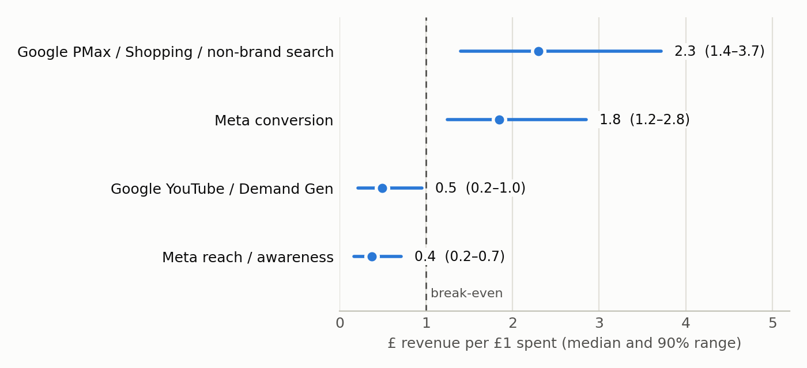
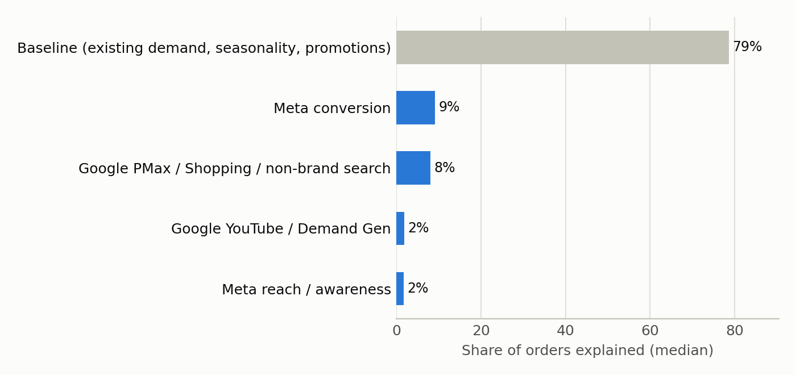
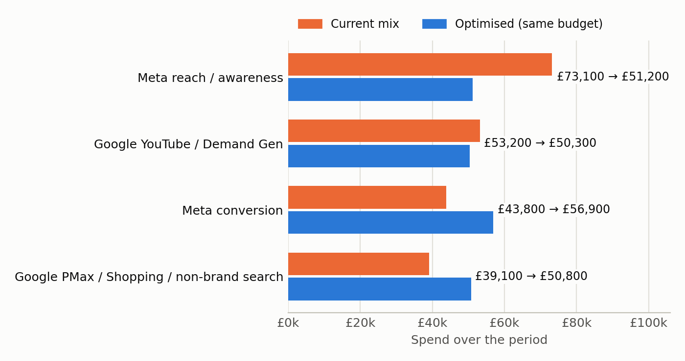

# Example Co marketing mix model — readout

*Model run `example-main` · Google Meridian 2.1.0 · weekly, UK / DE / FR / NORDICS, 2023-01-02 → 2025-12-22 (156 weeks)*

## What the model says

- **Paid media explains about 21% of orders. The other ~79% is the baseline**: people who already wanted the brand, seasonality and promotions.
- Across the paid channels, each £1 brought back about **£1.28** in revenue (90% range £0.97–£1.69).
- Highest return: **Google PMax / Shopping / non-brand search**. The ranges overlap, so treat the order as a guide, not a ranking.

## Channel table

| Channel | Spend | Return per £1 (median) | 90% range | Return on the next £1 | Share explained |
|---|---|---|---|---|---|
| Google PMax / Shopping / non-brand search | £476,711 | £2.29 | £1.40–£3.71 | £1.22 | 8.0% |
| Google YouTube / Demand Gen | £499,415 | £0.49 | £0.22–£0.95 | £0.23 | 1.8% |
| Meta conversion | £671,730 | £1.85 | £1.25–£2.85 | £0.96 | 9.1% |
| Meta reach / awareness | £615,735 | £0.38 | £0.17–£0.71 | £0.17 | 1.7% |

*Return on the next £1* is the budget number: move money from channels where it is low to channels where it is high.

`brand_search_spend` (£23,892) isn't modelled as a channel: it mostly reaches people who already want the brand, so it is used to measure demand instead.

## Nov–Dec scenarios

Last year's Nov–Dec weekly pattern stands in for this year's. Each channel can move up to ±30% from its share.

| Budget | Current mix: extra revenue | Optimised: extra revenue | Uplift |
|---|---|---|---|
| £167,400 (×0.8) | £173,939 | £187,044 | +7.5% |
| £209,200 (×1.0) | £193,013 | £205,699 | +6.6% |
| £251,000 (×1.2) | £208,504 | £220,689 | +5.8% |

A small uplift means the current split is already close to efficient; at peak spend the bigger lever is often the budget level, not the split.

## How far to trust it

Each check hides some weeks from the model, then asks it to predict them.

| Check | Fit on hidden weeks (R², higher is better) | Error on hidden weeks (wMAPE, lower is better) | Converged (R-hat < 1.1) | Meridian review |
|---|---|---|---|---|
| Random 10% of weeks | 0.99 | 0.04 | 1.03 | PASS |
| Q4 2024 held out, UK only | 0.93 | 0.06 | 1.02 | PASS |
| Q4 2024 held out, all markets | 0.42 | 0.18 | 2.12 | FAIL |

## What moves the answer

Each run changes one setting. Channels whose return holds steady are robust; the ones that move lean on that setting.

| Change | Google PMax / Shopping / non-brand search | Google YouTube / Demand Gen | Meta conversion | Meta reach / awareness | Paid share |
|---|---|---|---|---|---|
| **Main fit** | £2.29 | £0.49 | £1.85 | £0.38 | 21% |
| Demand control: trends | £2.43 | £0.85 | £1.93 | £0.60 | 25% |
| No demand control | £3.30 | £0.59 | £2.62 | £0.78 | 31% |

## Caveats

- **Online sales only.** Retail and marketplace sales aren't in the data, so brand activity that sends people to shops is under-counted.
- **Upper-funnel returns are uncertain.** Video and reach ran in a few flights, mostly at seasonal peaks, so their ranges lean on the priors.
- **Channels outside the model** (email, TV, influencers) may have their effect credited to the paid media that ran at the same time.
- Every judgement call and open question is in the assumptions register.
